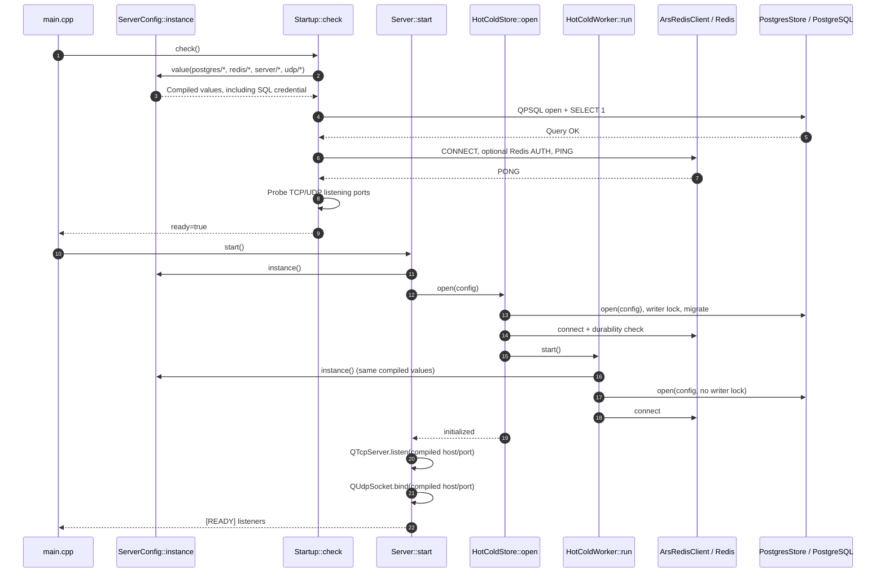
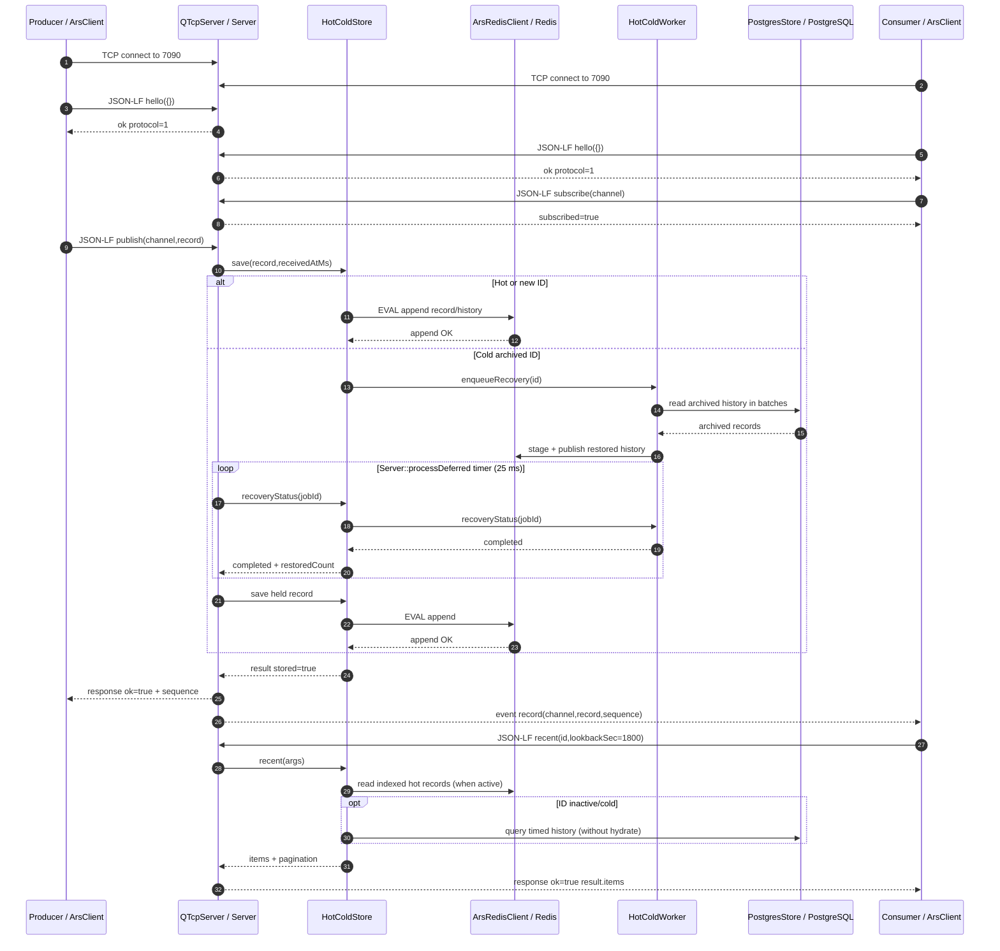
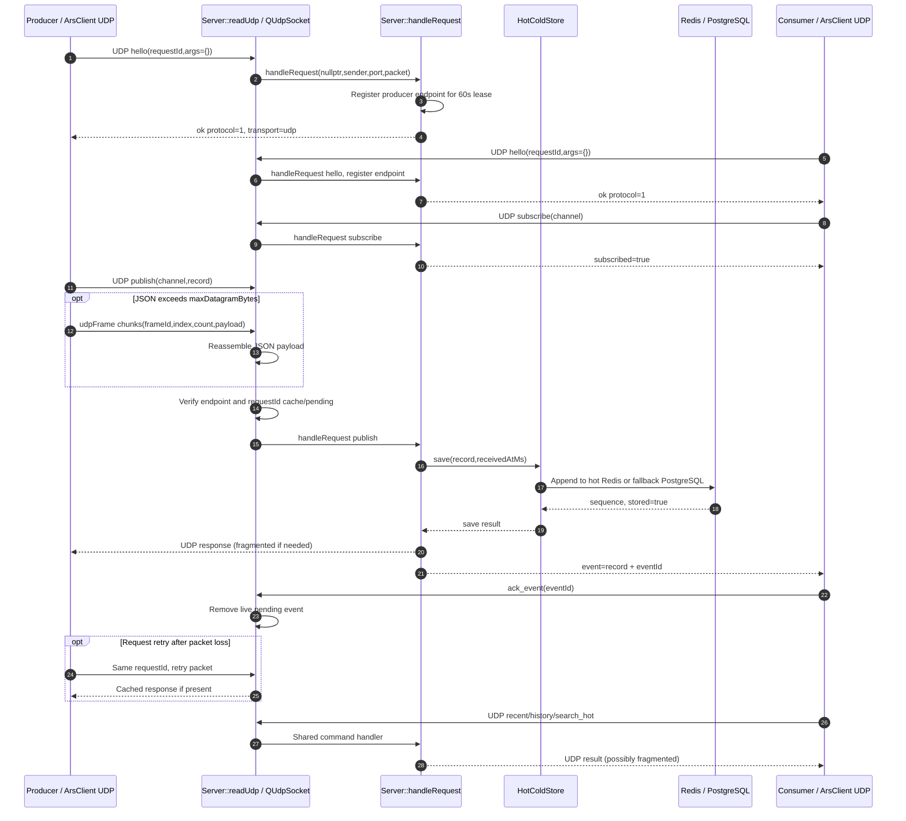
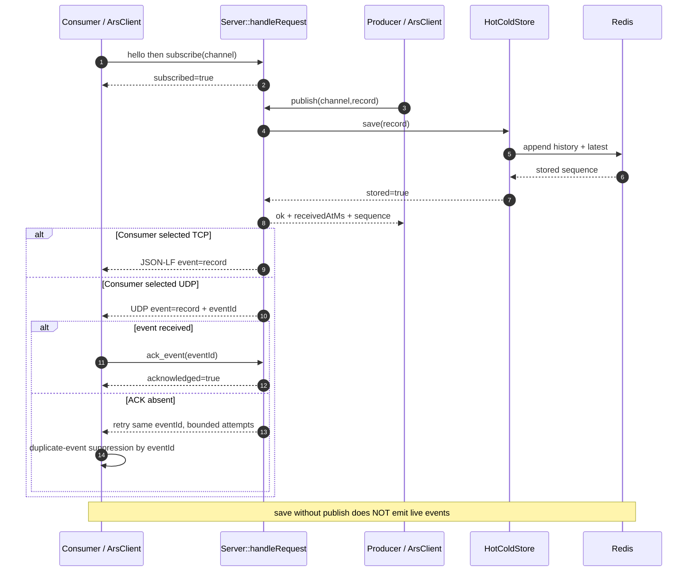
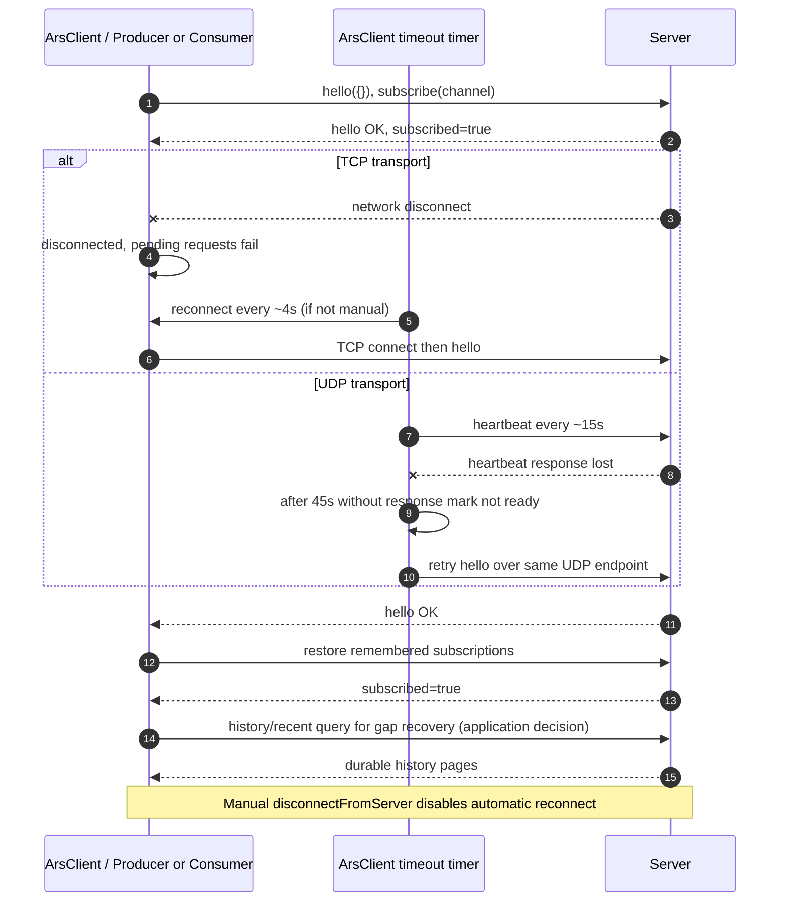

# معماری واقعی ARS — نسخه بدون توکن (TCP و UDP)

این مستند بر پایه سورس اصلاح‌شده همین ZIP نوشته شده است. هر کلاینت از ابتدا **TCP یا UDP** را انتخاب می‌کند و تمام APIها را با همان transport ادامه می‌دهد. `Server::handleRequest` مسیر مشترک هر دو است. Redis و PostgreSQL فقط از Server/Worker قابل دسترسی هستند.

## کلاس‌ها و مسئولیت‌ها

| فایل/کلاس | مسئولیت |
|---|---|
| `server/server/main.cpp` | اجرای `--check`، شروع Server با تنظیمات کامپایل‌شده |
| `Startup` | خواندن `ServerConfig::instance()` و بررسی اتصال Redis/PostgreSQL و پورت‌ها |
| `Server` | Listenerهای TCP و UDP، پردازش JSON، `hello` بدون رمز، dispatch، Live و ACK |
| `HotColdStore` | حفظ تاریخچه گرم و عملیات `save`, `publish`, `latest`, `history`, `recent`, `search_hot` |
| `HotColdWorker` | checkpoint، archive، recover و پیگیری Worker |
| `ArsRedisClient` | دستورات Redis از سمت سرور |
| `PostgresStore` | اتصال QPSQL با رمز کامپایل‌شده از ServerConfig؛ تاریخچه سرد |
| `ArsDataRecord` | مدل داده مستقل از لایه شبکه |
| `ArsClient` در Producer/Consumer | API یکسان و انتخاب TCP/UDP، handshake بدون token |

**نکته:** `hello` صرفاً اعلام شروع ارتباط است و احراز هویت انجام نمی‌دهد. پورت‌های پیش‌فرض فقط روی `127.0.0.1` باز می‌شوند؛ دسترسی LAN را در صورت نیاز با Firewall کنترل کنید.

## ۱. Server Startup & Redis Initialization

شروع سرویس، خواندن مقادیر کامپایل‌شده از `ServerConfig`، بررسی Redis و PostgreSQL، ساخت Worker و بازکردن Listenerها.

## ۲. TCP Producer/Consumer Communication

هر کلاینت از همان TCP برای hello، Subscribe، Publish و Query استفاده می‌کند. انتشار Live بعد از ثبت موفق انجام می‌شود.

## ۳. UDP Data Flow

هر کلاینت UDP با hello endpoint خود را ثبت می‌کند؛ همان فرمان‌های اصلی و پاسخ‌ها در UDP اجرا می‌شوند. ACK/Retry و fragmentation برقرار است.

## ۴. Realtime Publish/Subscribe

Consumer ابتدا مشترک می‌شود. Server پس از ذخیره publish، برای TCP یک event و برای UDP event دارای eventId می‌فرستد.

## ۵. Client Disconnect & Reconnection

Timeout و reconnect با همان پروتکل انتخاب‌شده انجام می‌شود. اشتراک‌های نگهداری‌شده بعد از hello دوباره ثبت می‌شوند.

## آزمون و محدودیت

این Sequence Diagramها مسیرهای موجود در **کد اصلاح‌شده** را نشان می‌دهند؛ Build واقعی Qt 6.7 و اجرای end-to-end با Redis/PostgreSQL هنوز در محیط حاضر انجام نشده است. UDP تضمین تحویل سراسری ندارد. بازیابی gap رویدادهای Live با درخواست `recent/history` تصمیم برنامه مصرف‌کننده است و SDK آن را به‌صورت خودکار تضمین نمی‌کند.
