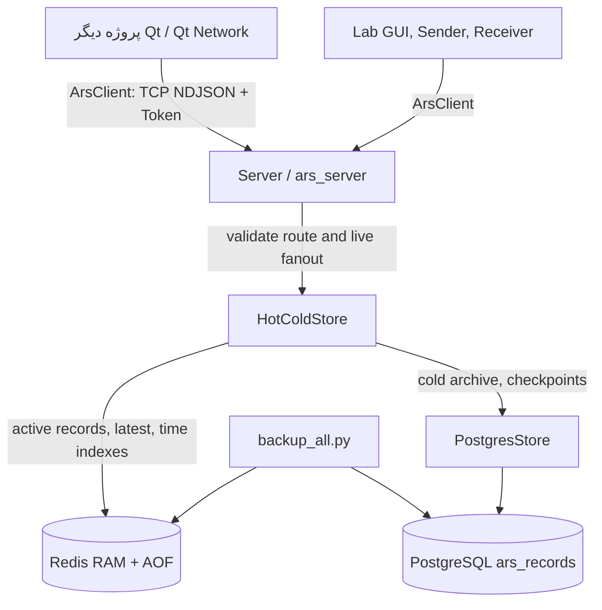
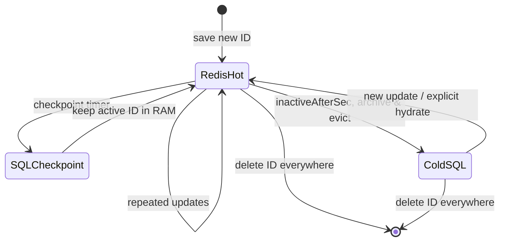

> **مستند قدیمی**: مسیرهای INI/Build در این سند منسوخ‌اند. به `tests/reference_lab/run_lab.sh` جدید و `docs/13_COMPILED_CONFIG_FA.md` مراجعه کن.

# معماری کامل سرویس ARS و فهرست کلاس‌ها

## ۱. این معماری دقیقاً چیست؟

**ARS Central** یک سرویس C++17/Qt است که روی TCP پیام‌های JSON سطری (NDJSON) می‌پذیرد. کلاینت بیرونی فقط به **ARS Server** متصل می‌شود. سرور برای IDهای فعال از Redis و برای آرشیو و ذخیره دوره‌ای از PostgreSQL استفاده می‌کند. در لحظه سرور تنها نویسنده Redis Hot تحت namespace خودش فرض شده است. نام `ArsRedisService` در شاخه legacy مربوط به طراحی قدیمی SQLite است و **ورودگاه توصیه‌شده سرویس مرکزی نیست**.



هسته دو مسیر دارد: **Hot** (ID فعال، Redis) و **Cold** (ID غیرفعال، PostgreSQL). هر `save` زمان دریافت روی سرور `receivedAtMs` می‌گیرد و هر رکورد شماره `sequence` یکتا دریافت می‌کند. زمان `timestamp` متعلق به تولیدکننده است و ممکن است قدیمی باشد. مقدار `latest` بر اساس timestamp رویداد است؛ `recent` بر اساس زمان دریافت سرور.

## ۲. کلاس‌های اصلی معماری مرکزی

| کلاس / ساختار | فایل | وظیفه | در پروژه دیگر کپی شود؟ |
|---|---|---|---|
| `ArsDataRecord` | `include/ARS/ArsDataRecord.h`, `src/Core/ArsDataRecord.cpp` | مدل پیام، زمان تولید، ID، مختصات، سرعت، payload و `features`، تبدیل JSON | **بله** |
| `ArsClient` | `central/client/ArsClient.h/.cpp` | اتصال TCP، احراز هویت، درخواست/پاسخ غیرهمگام، دریافت پیام زنده، تایم‌اوت، API | **بله** |
| `ArsClient::Pending` | داخل `ArsClient.h` | ساختار خصوصی نگهداری عملیات منتظر پاسخ، requestId، زمان انقضا | خیر؛ داخلی |
| `Server` | `central/server/Server.h/.cpp` | TCP Listener، نگهداری اتصال‌ها، اعتبارسنجی ورودی، مسیریابی عملیات، ارسال Live Event | خیر؛ فقط سرور |
| `Server::Peer` | داخل `Server.h` | وضعیت هر اتصال، buffer، احراز هویت، کانال‌های Subscribe | خیر؛ داخلی |
| `HotColdStore` | `central/server/HotColdStore.h/.cpp` | مغز Hot/Cold؛ ذخیره در Redis، بازیابی، آرشیو، سرچ RAM، تاریخچه زمانی، نگهداری checkpoint | خیر؛ فقط سرور |
| `PostgresStore` | `central/server/PostgresStore.h/.cpp` | بازکردن QPSQL، ساخت Schema، نگهداری و واکشی آرشیو، تاریخچه، رزرو sequence، پاک‌سازی ID | خیر؛ فقط سرور |
| `ArsRedisClient` | `src/Redis/ArsRedisClient.h/.cpp` | اجرای همگام دستورات RESP به Redis و دریافت پاسخ | خیر؛ سرور مصرف می‌کند |
| `ArsRedisReply` | `src/Redis/ArsRedisClient.h` | نمایش نتیجه RESP: String، Integer، Array، Nil یا Error | خیر؛ داخلی |

### فراخوانی نمونه از Qt

`MyApp` → `ArsClient::saveRecord(record)` → `ArsClient::send("save")` → `Server::handle()` → `HotColdStore::save()` → Redis (یا fallback PostgreSQL) → `Server::write()` → `ArsClient::responseReceived()`.

**برای دریافت زنده**، پروژه گیرنده `subscribeLive("channel")` می‌فرستد؛ سرور هنگام اجرای `publishLive` رکورد را ذخیره و سپس به همه Peerهای عضو همان channel ارسال می‌کند. این مکانیزم توزیع زنده در همین `Server` است، نه اتصال مستقیم کلاینت به Pub/Sub داخلی Redis.

## ۳. متدهای کلاس `ArsClient`

| متد | وظیفه | پاسخ/Signal |
|---|---|---|
| `connectToServer(host,port,token)` | اتصال و Auth با Token | `ready()`, `connectionError(...)` |
| `disconnectFromServer()` | قطع اتصال | `disconnected()` |
| `isReady()` | آیا تأیید هویت انجام شده؟ | `bool` |
| `saveRecord(record)` | ذخیره رکورد، بدون انتشار زنده | `responseReceived(...,"save",result)` |
| `publishLive(channel,record)` | ذخیره رکورد + انتشار زنده به مشترک‌ها | `responseReceived(...,"publish",result)` |
| `getLatest(id)` | آخرین رکورد ID از Redis یا SQL | `latest` |
| `queryHistory(id,fromMs,toMs,limit,timeField,afterSequence,untilSequence)` | تاریخچه با timeField=`timestamp` یا `receivedAt`، صفحات مبتنی بر sequence | `history` |
| `recentHistory(id,lookbackSec,limit)` | تاریخچه ۱۸۰۰/۳۶۰۰ ثانیه اخیر بر پایه زمان دریافت | `recent` |
| `recentHistoryPage(id,fromMs,toMs,offset,limit)` | صفحه بعدی همان پنجره زمانی | `recent` |
| `searchHot(mode,filters,idContains,cursor,limit,scanBudget)` | جست‌وجوی **فقط RAM** (`latest` یا `records`) | `search_hot` |
| `subscribeLive(channel)` / `unsubscribeLive(channel)` | دریافت/قطع رویدادهای کانال | `subscribe`, `unsubscribe` |
| `deleteById(id,false)` | آرشیو و خروج کپی Hot از Redis | `delete` |
| `deleteById(id,true)` | حذف ID و تاریخچه از Redis و PostgreSQL | `delete` |
| `hydrateToCache(id)` | صف‌کردن بازیابی غیرهمگام تاریخچه سرد ID | `hydrate` |
| `status()` | سلامت و زمان‌بندی سرویس | `status` |

**همه متدهای درخواست (به‌جز `isReady`) به‌صورت غیرهمگام هستند و یک `requestId` از نوع QString برمی‌گردانند**. نتیجه همان لحظه در مقدار برگشتی نیست؛ نتیجه در `responseReceived(requestId,operation,result)` یا `requestFailed(...)` می‌آید. سیگنال `liveRecordDetailed(channel,record,sequence,receivedAtMs)` اطلاعات زمان سرور را نیز دارد. به‌دلیل محدودیت ۱۵ ثانیه‌ای درخواست، اگر ارتباط قطع شود نتیجه ذخیره ممکن است نامعلوم باشد؛ ارسال مجدد کورکورانه ممکن است رکورد تکراری بسازد.

## ۴. متدهای اصلی `HotColdStore`

| متد | کارکرد | نکته |
|---|---|---|
| `open(QSettings&)` | اتصال Redis/Postgres، آماده‌سازی Timerها | بدون Redis: fallback PostgreSQL |
| `save(...)` | ایجاد/به‌روزرسانی تاریخچه فعال | cold ID را قبل از save از SQL بازیابی می‌کند |
| `latest(...)` | واکشی آخرین وضعیت | Redis اول، SQL دوم |
| `history(...)` | خواندن تاریخچه مبتنی بر sequence | روی Hot از Redis |
| `recent(...)` | بازه زمانی بر اساس `receivedAtMs` | روی cold مستقیماً SQL |
| `searchHot(...)` | اسکن محدود و صفحه‌بندی‌شده Hot | فقط Redis؛ جست‌وجوی full index نیست |
| `hydrate(...)` | صف‌کردن بازیابی دستی سابقه ID | پاسخ فوری؛ وضعیت با `recovery_status` |
| `remove(...)` | evict cache یا delete everywhere | مسیر حذف باید کاملاً کنترل شود |
| `sweepInactive()` | Timer: کشف IDهای بی‌فعالیت و checkpoint سپس evict | Log `[ARCHIVED]` |
| `checkpointActive()` / `checkpointTick()` | Timer: گردش در IDهای فعال و آرشیو افزایشی | Log `[CHECKPOINT]` و `[CHECKPOINT_DONE]` |
| `flushId(...)` | انتقال batchهای ثبت‌نشده به SQL | تأیید SQL قبل از تغییر synced offset |
| Recovery job در `HotColdWorker` | بارگذاری Batch/stream تاریخچه در staging و انتشار اتمیک | `recovery_status` |
| `active(...)`, `append(...)`, `command(...)`, `nextSequence(...)` | کمک‌متدهای Redis و sequence | داخلی |

`PostgresStore` متدهای `open`, `migrate`, `save`, `latest`, `history`, `recent`, `loadAll`, `archiveBatch`, `reserveSequences`, `remove`, `healthy` دارد. مهاجرت SQL جدول `ars_records` و indexهای `id+timestamp`, `id+received_at_ms`, `id+sequence` را آماده می‌کند. `archiveBatch` در تراکنش انجام می‌شود و با `ON CONFLICT(sequence) DO NOTHING` از درج دوباره sequence جلوگیری می‌کند.

## ۵. ساختار داده واقعی در Redis و PostgreSQL

پیشوند کلید Redis آزمایش `ars_lab_2026:hotv1:` است. پسوند شناسه‌ها برای جلوگیری از برخورد نام کلید، به Base64 URL-safe تبدیل می‌شود.

| کلید Redis | نوع | کاربرد |
|---|---|---|
| `...:history:<encoded-id>` | List | تمام رکوردهای ID فعال، به ترتیب دریافت |
| `...:latest:<encoded-id>` | String(JSON) | آخرین وضعیت بر اساس event timestamp |
| `...:recvIndex:<encoded-id>` | Sorted Set | ایندکس زمان دریافت → موقعیت رکورد در List |
| `...:lastSeen` | Sorted Set | آخرین دریافت هر ID فعال، معیار عدم فعالیت |
| `...:synced` | Hash | تعداد رکوردهای ID که به PostgreSQL checkpoint شده‌اند |
| `...:staging:<uuid>`, `...:staging_index:<uuid>` | List/ZSet موقت | ساخت امن کپی آرشیو در RAM قبل از RENAME |

جدول PostgreSQL `ars_records` این ستون‌ها را دارد: `sequence BIGINT PRIMARY KEY`، `id TEXT`، `timestamp_ms BIGINT`، `received_at_ms BIGINT`، `record JSONB`. هنگام خواندن تاریخچه Hot، منبع `redis` و هنگام خواندن آرشیو Cold، منبع `postgres` در پاسخ برمی‌گردد.

## ۶. چرخه داده



مثال با بازه ۸ ثانیه در آزمایش: `A` هر نیم‌ثانیه رکورد می‌فرستد و Hot می‌ماند. `B` بعد از ارسال پنج رکورد ۱۲ ثانیه ساکت می‌شود. پس از checkpoint، B آرشیو و از RAM حذف می‌شود. `recent(B,1800)` همان لحظه مستقیم از SQL خوانده می‌شود. وقتی B دوباره برسد، درخواست فوراً یک Recovery job صف می‌کند؛ پس از تکمیل job، کلاینت باید write را تکرار کند تا رکورد جدید append شود. دریافت سرور در `receivedAtMs` محفوظ است.

## ۷. شاخه Legacy (قدیمی و مستقل از سرویس مرکزی)

این شاخه هنوز در ZIP باقی است اما با تنظیم پیش‌فرض `ARS_BUILD_LEGACY=OFF` ساخته نمی‌شود؛ هنگام اضافه‌کردن به پروژه جدید از آن استفاده نکن:

| کلاس/ساختار | مسیر | کاربرد پیشین |
|---|---|---|
| `ArsRedisService` | `include/ARS/ArsRedisService.h`, `src/ArsRedisService.cpp` | API قدیمی مستقیم Redis/SQLite به صورت Singleton |
| `ArsStorageOrchestrator` | `src/Core/ArsStorageOrchestrator.h/.cpp` | هماهنگ‌کننده Redis و SQLite در نسخه legacy |
| `ArsRedisSubscriber` | `src/Redis/ArsRedisSubscriber.h/.cpp` | Subscriber مستقیم Redis در نسخه قدیمی |
| `ArsSqliteStorage` | `src/Disk/ArsSqliteStorage.h/.cpp` | ذخیره سرد SQLite قدیمی |
| `ArsConfig` | `include/ARS/ArsConfig.h` | تنظیمات قدیمی Redis/SQLite |

تفاوت کلیدی: `ArsClient` وابسته به Redis مستقیم نیست؛ `ArsRedisService` مربوط به طراحی قدیمی است. هم‌نام بودن بعضی عملیات مثل `deleteById` به معنی یکسان بودن پشتیبان ذخیره آن‌ها نیست.

## ۸. سرعت، ایمنی و محدودیت‌ها (پیش از Release)

- درخواست‌های Redis و SQL در `HotColdStore` عمدتاً **همگام** هستند و بازسازی تاریخچه بزرگ می‌تواند Event Loop سرور را مسدود کند؛ نرخ بالا و hard realtime تضمین‌شده نیست.
- `searchHot` یک جست‌وجوی صفحه‌بندی‌شده با scan budget است، نه Redis Search با index ثانویه. Cursor هنگام ورود/حذف IDها Snapshot پایدار نیست؛ برای گزارش مالی یا جست‌وجوی چند میلیون رکورد باید فهرست‌های ایندکس‌شده، Worker و snapshot strategy اضافه کرد.
- بازگشت یک ID که تاریخچه بسیار بزرگ دارد، کل آرشیو آن ID را به Redis کپی می‌کند. دسترسی **فقط** به نیم‌ساعت گذشته با `recent` روی cold ID چنین کاری نمی‌کند.
- Redis در حالت fallback ممکن است کنار برود و PostgreSQL مقصد مستقیم شود. پس از رفع قطعی Redis، همگام‌سازی خودکار دو مخزن به‌طور کامل برای تمام سناریوهای failure طراحی/تست نشده است.
- فقط Token مشترک وجود دارد: **RBAC / TLS / audit مدیریتی وجود ندارد**. هر کلاینت دارای Token امکان `delete` دارد! در شبکه غیرمطمئن در معرض اینترنت قرار نده و در تولید سیاست مجوز مستقل اضافه کن.
- Snapshotهای PostgreSQL و Redis بدون توقف نوشتن، اتمیک مشترک نیستند. AOF، حجم RAM، رکوردهای بسیار زیاد و recovery باید در استقرار واقعی جداگانه تست شوند.
- `server.ini` حاوی رمز PostgreSQL نیست: رمز فقط از متغیر `ARS_DB_PASSWORD` خوانده می‌شود؛ Token فقط `ARS_API_TOKEN` و رمز Redis در صورت وجود `ARS_REDIS_PASSWORD` است.

## ۹. کلاس‌ها و ساختارهای ابزار آزمایش و نمونه ادغام

| نام | فایل | نقش |
|---|---|---|
| `LabWindow` | `central/lab/gui/LabWindow.h/.cpp` | محیط گرافیکی آزمایش برای اتصال، تولید رکورد، تاریخچه، سرچ و حذف ID |
| `TelemetryBridge` | `examples/independent_qt_app/TelemetryBridge.h/.cpp` | لایه واسط آموزشی در یک اپ Qt مستقل؛ Wrapping از `ArsClient` و تبدیل رویدادها به Signalهای برنامه |
| `Page`, `RecentPage`, `SearchPage` | `central/test_apps/receiver.cpp` | ساختارهای محلی گیرنده برای نگهداری cursor و موقعیت صفحه فعلی |
| `Client` | `central/tests/hot_cold_end_to_end.py` | کلاینت TCP Python برای آزمون end-to-end بدون کتابخانه اضافی |
| `Peer` | `central/tests/integration.py` | کلاینت TCP Python برای آزمودن خطاها و framing پیام |
| `ManagementToolsTest`, `ProvisioningTests` | `central/tests/test_management.py`, `test_provisioning.py` | تست ایمنی ابزارهای دیتابیس، بک‌آپ و ساخت اولیه |

`ars_server`، `ars_test_sender`, `ars_test_receiver`, `ars_client_demo`, `ars_all_features_demo`, `ars_lab_gui` و `independent_ars_app` **نام executable** هستند، نه کلاس. `ArsRedisReply` نیز struct است. برنامه `central/server/main.cpp` فقط `QCoreApplication` و شیء `Server` می‌سازد و `Server::start` را اجرا می‌کند.

## ۱۰. ساختار پروتکل ارتباطی

در ARS هر پیام یک JSON در یک سطر TCP است. مثال مستندات (توکن واقعی را در متغیر محیطی نگه دار):

```json
{"requestId":"123","op":"save","args":{"record":{"id":"A-42","timestamp":1794500000000,"speed":240,"features":{"category":"radar"}}}}
```

نمونه پاسخ موفق به همان requestId:

```json
{"requestId":"123","ok":true,"result":{"sequence":"987","receivedAtMs":1794500000123,"stored":true,"storage":"redis"}}
```

پاسخ رویداد زنده به requestId وابسته نیست، برای مثال:

```json
{"event":"record","channel":"sensors/live","record":{"id":"A-42","timestamp":1794500000000},"sequence":"987","receivedAtMs":1794500000123}
```

عملیات معتبر پروتکل: `auth`, `status`, `save`, `publish`, `subscribe`, `unsubscribe`, `latest`, `history`, `recent`, `search_hot`, `hydrate`, `recover`, `recovery_status`, `delete`. در سمت Qt همیشه از `ArsClient` استفاده کن؛ raw JSON صرفاً برای درک معماری و ساخت کلاینت غیـر Qt است. `auth` باید قبل از عملیات‌های دیگر انجام شود. `requestId` در پاسخ برای تطبیق درخواست‌ها مهم است؛ `sequence` رشته متنی است چون مقدار BIGINT ممکن است از دقت اعداد JSON بزرگ‌تر شود.

## ۱۱. تنظیمات مرکزی و رفتار آن‌ها

| مسیر `server.ini` | کارکرد |
|---|---|
| `server/host`, `server/port` | TCP listener؛ به‌صورت آزمایشی تنها 127.0.0.1 |
| `server/maxClients` | سقف هم‌زمان connectionها |
| `postgres/host`, `/port`, `/database`, `/user` | اتصال آرشیو؛ رمز از ARS_DB_PASSWORD |
| `redis/enabled`, `/host`, `/port`, `/db`, `/keyPrefix` | اتصال و namespace Hot؛ رمز از ARS_REDIS_PASSWORD |
| `redis/requireDurability` | در صورت ناایمنی AOF یا سیاست eviction، Redis Hot غیرفعال شود |
| `lifecycle/inactiveAfterSec` | آستانه سکوت ID قبل از آرشیو و خارج‌کردن کپی RAM |
| `lifecycle/checkpointEverySec` | فاصله شروع گردش ثبت دوره‌ای رکوردهای Hot در SQL |
| `lifecycle/scanEveryMs` | فاصله بررسی IDهای بی‌فعالیت |
| `lifecycle/batchSize`, `/maxBatchesPerSweep` | تعداد رکورد هر تراکنش و سقف batch در هر Sweep |

مقدار `requireDurability=true` در محیط آزمایش باعث می‌شود Redis صرفاً در صورت فعال‌بودن AOF و سیاست noeviction به‌عنوان Hot Store پذیرفته شود. این تضمین مصونیت مطلق در برابر خرابی سخت‌افزار نیست. تنظیمات production ممکن است با نیاز کارایی متفاوت باشند و باید بر اساس هدف RPO/RTO طراحی شوند.
